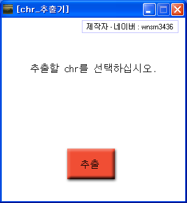

# Jurassic Primitive War 2 CHR Extractor

[한국어](README.ko.md)

The unit data files (CHR) of Jurassic Primitive War 2 are bundles that hold a unit's stats, graphics, sound and palette in one file. This extractor pulls the resources inside a CHR out as separate files, following an analysis of the header layout. Because it reads the counts and lengths from the header, it adapts to the different makeup of each unit.

The analysis is written up in [docs/chr-format.md](docs/chr-format.md).

<p>
  
</p>


## How to use

Download it from Releases, extract and run it, then press the extract button to open a file dialog. Pick the `.chr` file to extract, then choose where to save the results in the folder dialog that follows, and the rest runs on its own.

The output folder looks like this.

| Path | Contents |
|---|---|
| `<name>.cei` | Unit stats |
| `spr/j00_m0.pnt` | Palette |
| `spr/*.spz` | Unit images, named by animation category |
| `sound/*.wav` | Unit sounds |

If a file with the same name already exists in the output folder, the extractor creates a new one with the trailing number raised by one.


## How it works

**One function reads every multi-byte header field and is reused throughout.** Given a position and a byte count, it reads that many bytes back to front and assembles them as a little-endian value. The receiving variable is passed by name as a string and filled through `variable_local_set`. With more than twenty count fields scattered through the header, calling it one line at a time keeps things simple.

```gml
// sk_load_data(variable name, position, file, byte count)
file_bin_seek(argument2, argument1)
for(v=argument3-1; v!=-1; v-=1)
{
  file_bin_seek(argument2, argument1+v)
  variable_local_set(argument0,
    variable_local_get(argument0) + sk_hex_conversion(file_bin_read_byte(argument2)))
}
variable_local_set(argument0, sk_dec_conversion(variable_local_get(argument0)))
```

```gml
sk_load_data("rmax", 8720, files, 4)   // total image count
sk_load_data("rmg",  8724, files, 4)   // guard
sk_load_data("rmm",  8728, files, 4)   // move
sk_load_data("rma",  8732, files, 4)   // attack
...
```

The offsets above are written in decimal in the source. They match the hex values in the analysis ([docs/chr-format.md](docs/chr-format.md)).

**File names come from counting down the per-animation totals.** The header does not record which sprite belongs to which action, only how many of each there are. The order never changes, though, so a function counts each total down by one and returns the action whose turn it is. Extracted files come out carrying the action name, like `m0000.spz`.

```gml
// sk_spr_name()
if real(rmg)>0{rmg=string(real(rmg)-1); return "g"}
else if real(rmm)>0{rmm=string(real(rmm)-1); return "m"}
else if real(rma)>0{rma=string(real(rma)-1); return "a"}
...
```

**Extraction runs in stages driven by an alarm.** GameMaker freezes its window if one event runs for too long, so a `progress` variable splits the work into stages and each alarm tick advances one stage. The window gets a chance to redraw between stages, which is what allows status text like "spz추출중" ("extracting spz") to appear.

| Stage | Work |
|---|---|
| 0 | Read every count field in the header |
| 1 | Cut out the fixed CEI and PNT regions |
| 2 | Pull out the SPZ files one by one |
| 3 | Pull out the WAV files one by one |
| 4 | On the last alarm, show the completion message and return to the start screen |

**SPZ and WAV entries vary in length, so each one's header is read again.** Each entry's length is stored a short way past its start. The extractor reads that value, cuts out that many bytes, and moves the cursor forward by the same amount to reach the next entry. This repeats until the count runs out.

```gml
while(real(rmax) > 0)
{
  sk_load_data("goto", susk+24, files, 4); goto = string(real(goto)+32)
  ...
  file_bin_seek(files, susk)
  repeat(real(goto)){ file_bin_write_byte(files2, file_bin_read_byte(files)) }
  susk += real(goto)
}
```


## Files

| Path | Contents |
|---|---|
| `source/jw2-chr-extractor.gmk` | Original project file |
| `source/split/` | Text tree produced by GmkSplitter |
| `docs/chr-format.md` | CHR header offset analysis |
| `docs/screenshots/` | Screenshots |
| Releases | Executable and usage notes |


## Credits

The Korean text rendering scripts (`source/split/Scripts/한글드로우/`) were made by 김게맛 (sodium031) of the GameMaker community.


## License

zlib. See [LICENSE](LICENSE). Bundled libraries made by other people keep their own licenses.
